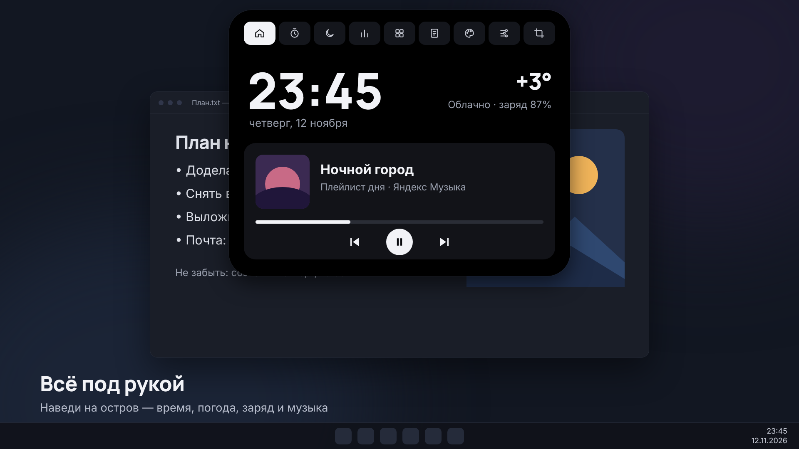
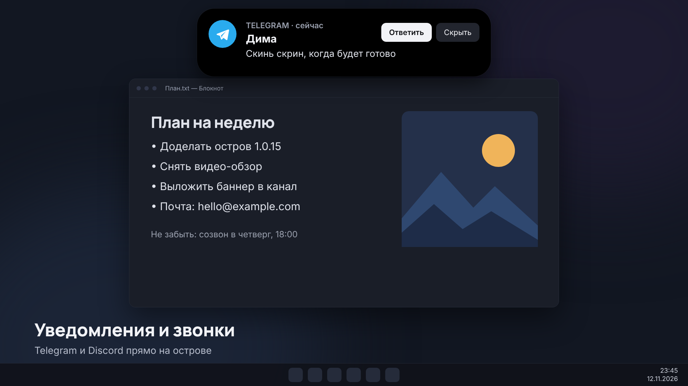
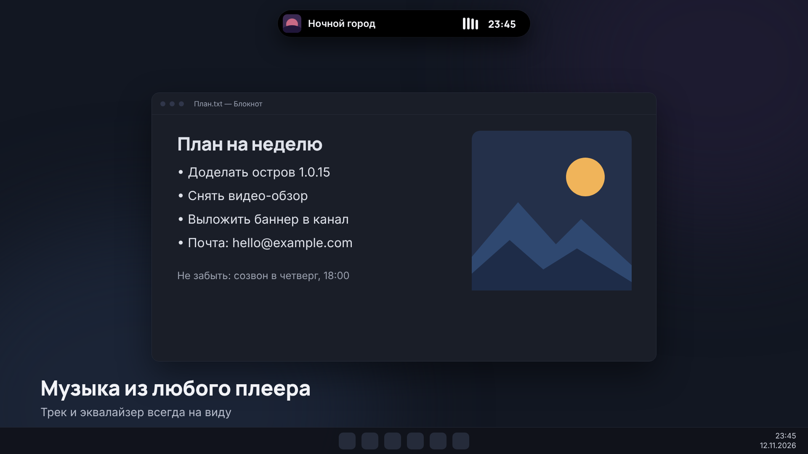
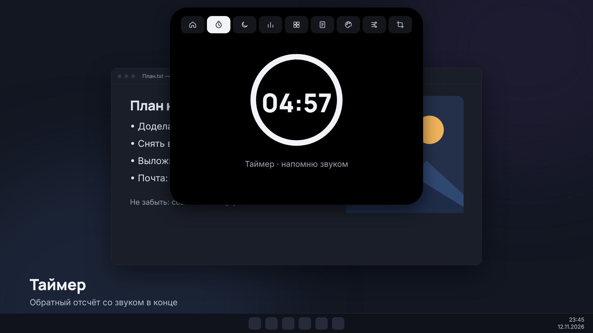
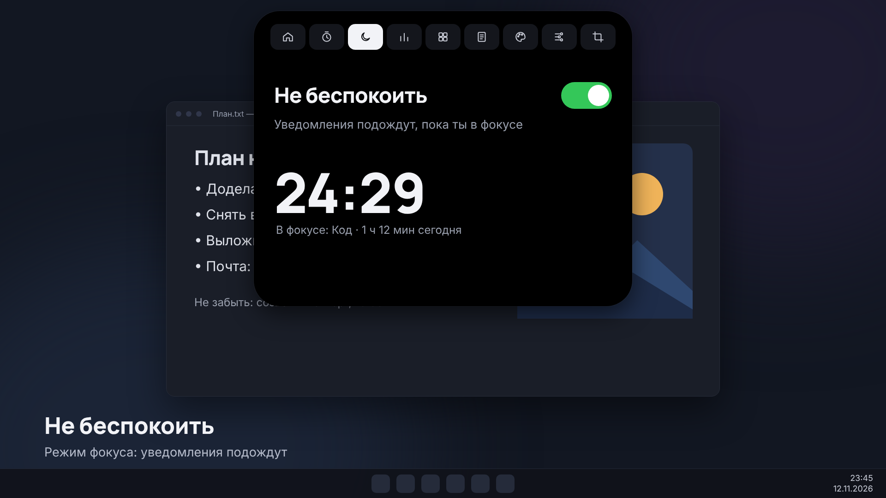
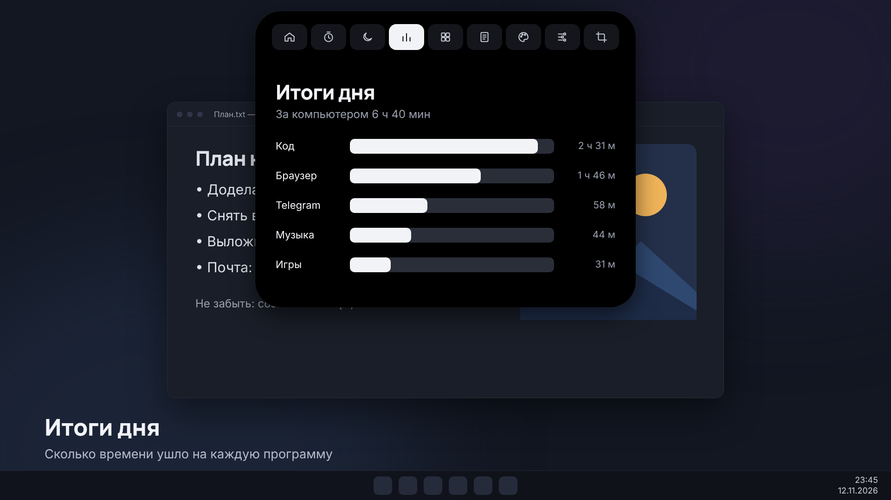
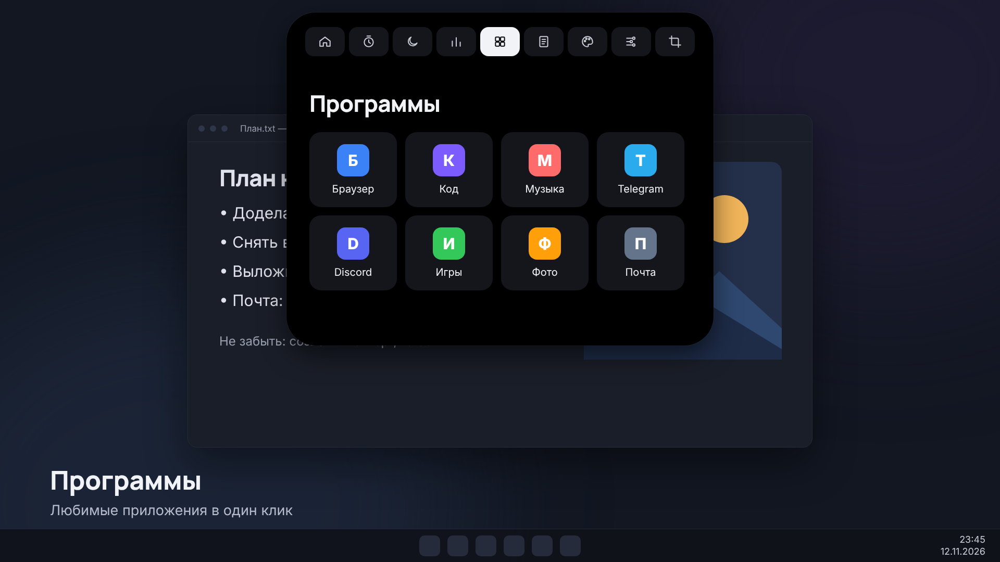
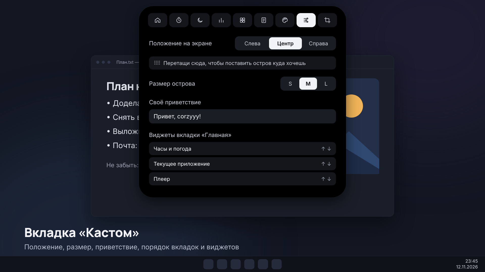
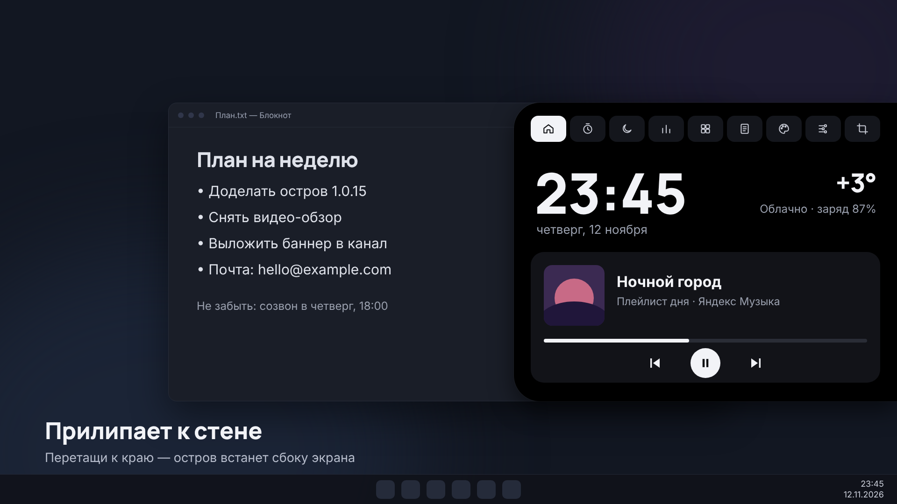
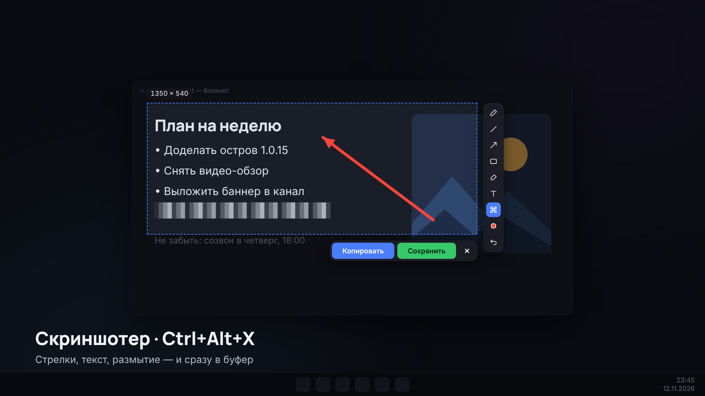

# Island for Windows

Маленькая чёрная таблетка у верхнего края экрана. Всегда поверх окон, клики проходят сквозь неё, пока ты не наведёшь курсор.

Приложение теперь поддерживает русский и английский интерфейс — язык выбирается при первом запуске (его можно сменить позже на вкладке «Дизайн»).

## Запуск

1. Установи Node.js (версия LTS): https://nodejs.org
2. Открой терминал в этой папке.
3. Выполни по очереди:

```
npm install
npm start
```

Первая установка скачает Electron, это около 100 МБ.

## Что умеет

- В покое показывает время.
- Наведи курсор, и остров раскроется: время, дата, заряд батареи, таймер (5, 25 или 45 минут).
- Идёт таймер: остров сам сворачивается в маленькую плашку с обратным отсчётом.
- Таймер закончился: звуковой сигнал и всплывающее «Таймер завершён».
- Подключил или отключил зарядку: остров показывает всплывашку. При заряде 20% и ниже предупреждает.
- Музыка из любого плеера: трек, обложка и управление прямо на острове.
- Уведомления и звонки из Telegram и Discord.
- Вкладки: таймер, «Не беспокоить», итоги дня, программы, заметки, дизайн.
- Вкладка «Кастом»: положение и размер острова, своё приветствие, порядок вкладок и виджетов, сброс всего одной кнопкой.
- Остров можно схватить мышкой и перетащить; у левого или правого края он прилипает к стене узкой полоской.
- Скриншотер (Ctrl + Alt + X): выделение области, стрелки, текст, маркер, размытие, копирование в буфер и сохранение.

## Скриншоты

| | |
| --- | --- |
|  |  |
|  |  |
|  |  |
|  |  |
|  |  |

English screenshots: [screenshots/en](screenshots/en).

## Горячие клавиши

| Клавиши | Что делает |
| --- | --- |
| Ctrl + Alt + I | раскрыть или свернуть остров |
| Ctrl + Alt + T | старт или пауза таймера |
| Ctrl + Alt + X | скриншот области |
| Ctrl + Alt + Q | закрыть программу |

Закрыть можно и крестиком в раскрытом острове.

## Если что-то не так

- Остров не по центру: он ставится на основной монитор. Для другого экрана поменяй `screen.getPrimaryDisplay()` в `main.js`.
- Горячие клавиши не срабатывают: их мог занять другой процесс, поменяй сочетания в `main.js`.
- Хочешь, чтобы остров запускался вместе с Windows: добавь ярлык на `npm start` в папку автозагрузки (Win+R, затем `shell:startup`).

## Автор

Telegram: [corzyyy](https://t.me/corzyyy)

Политика конфиденциальности и условия использования: файл `license.txt` (показывается при установке).

Погода (если включить блок «Погода» в «Дизайне»): данные [Open-Meteo.com](https://open-meteo.com/) по лицензии CC BY 4.0.


## Лицензия: Free / Pro

- **Free** — только главная страница (часы, батарея, плеер, таймер).
- **Pro** — все вкладки. Тарифы: 7 дней бесплатно за подписку на канал https://t.me/corzyyy, 15 дней — 69 ₽, 30 дней — 99 ₽, 3 месяца — 289 ₽, 6 месяцев — 577 ₽, 12 месяцев — 1150 ₽, навсегда — 3441 ₽.
- Ключ вида `IFW1-…` вводится в приложении (кнопка «Free» внизу острова). Срок считается с момента активации. Проверка офлайн, без интернета.
- Покупка и ключи: Telegram t.me/corzyyy.
- Все ключи привязаны к одному компьютеру: покупатель присылает «Код компьютера» (экран ключа в приложении).
